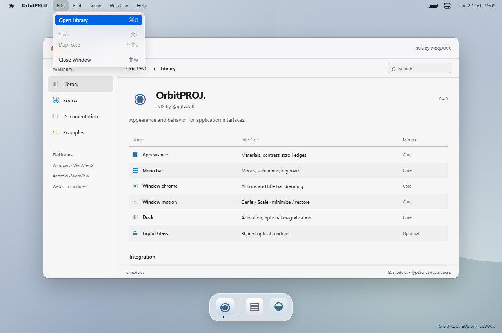
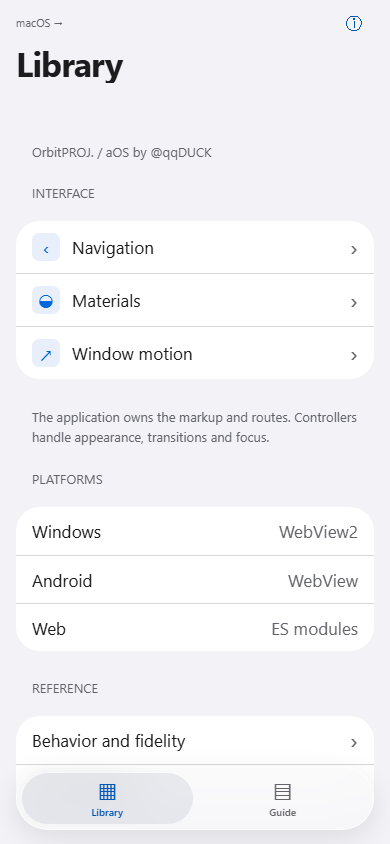
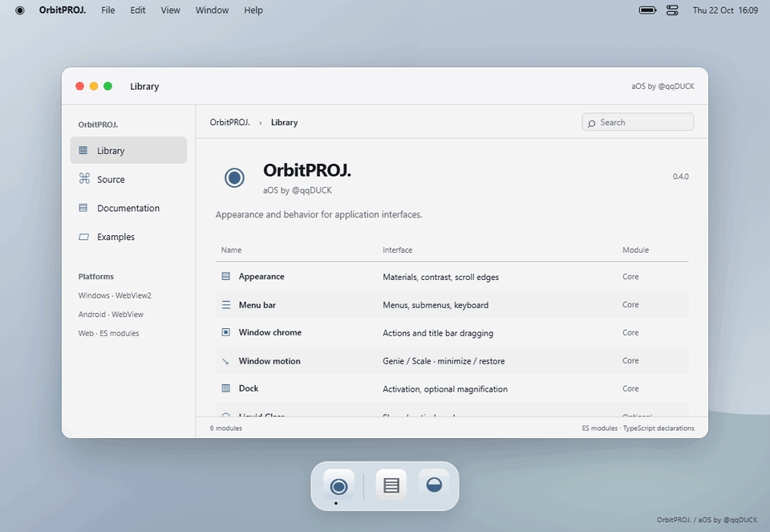

# OrbitPROJ.

### aOS by @qqDUCK

Appearance, menu behavior and window motion for **Windows, Android and web applications**.



[Русский](README.ru.md) · [Import and integration](docs/guide.en.md) · [API](docs/api.en.md) · [Reference and fidelity](docs/reference.en.md)

Attach materials and behavior to your application's markup. Menu commands, navigation and application state stay in your code. Liquid Glass is an optional renderer, alongside standard materials, window chrome, menu controllers and Dock behavior.

| Module          | Provides                                                                                                                                |
| --------------- | --------------------------------------------------------------------------------------------------------------------------------------- |
| Appearance      | Standard materials; Regular/Clear fallback surfaces; light/dark preferences; explicit backdrop contrast; concentric radii; scroll edges |
| Menu bar        | Opening, switching, submenus, disabled commands, typeahead, arrows and focus restoration                                                |
| Window chrome   | Close/minimize/zoom callbacks and title bar drag events                                                                                 |
| Window motion   | Genie mesh or Scale, minimize/restore, bottom/left/right targets, cancellation and reduced motion                                       |
| Dock and panels | Activation, opt-in magnification, anchored nonmodal panels                                                                              |
| Optional optics | Refraction, cached shared blur, SDF union, masks, morphology and materialization                                                        |

The primary API supplies appearance and controllers. Applications provide their own semantic elements, commands and state.

## iOS navigation



An optional module adds push/pop transitions, an interactive back driver, collapsing large titles, tab selection and modal sheet detents. The app supplies its markup and routing. [API and integration](docs/ios.en.md).

```js
import { createNavigationStack, createSheet } from "@qqduck/aos/ios";
import "@qqduck/aos/ios.css";
```

## Window motion



Recorded from the included application. The mesh and timing are independent estimates. **Exact visual parity with Apple has not been established.**

## Import

The package is not on npm. Install directly from this repository:

```sh
npm install github:golodgolub-bit/OrbitPROJ-aOS#main
```

Or download the [installable package](releases/qqduck-aos-0.4.0.tgz) and install it locally:

```sh
npm install ./qqduck-aos-0.4.0.tgz
```

```js
import { createAppearance, bindMenuBar } from "@qqduck/aos";
import "@qqduck/aos/styles.css";

const appearance = createAppearance({ root: appRoot });
const material = appearance.surface(yourSidebar, {
  family: "standard",
  variant: "thin",
  size: "large",
});
const menus = bindMenuBar(yourMenuBar, {
  onCommand: ({ id }) => dispatchCommand(id),
});

// On unmount:
menus.dispose();
appearance.dispose(); // also releases its surface and scroll-edge bindings
```

Supply semantic HTML menus with `aria-controls`, `role="menu"`, `role="menuitem"` and `data-command`. [Complete example](examples/vanilla/index.html), [React lifecycle](examples/react/Appearance.tsx), [window snapshot contract](docs/api.en.md).

Optical rendering is a separate import:

```js
import { createGlassScene } from "@qqduck/aos/scene";
const scene = createGlassScene(canvas, yourBackdrop, { material: "regular" });
// Your app supplies the backdrop pixels and shape geometry.
```

[Optical API](docs/material.en.md) · [Performance](docs/performance.md)

## Run and embed

```sh
npm run demo
```

Open **http://127.0.0.1:4173**. `Start-demo.cmd` starts it on Windows. No dependency installation is needed to view the demo.

| Target  | Supplied integration                               | Validation                                                 |
| ------- | -------------------------------------------------- | ---------------------------------------------------------- |
| Windows | WPF / WebView2 source host                         | Release compilation checked; runtime/device checks pending |
| Android | Java / WebViewAssetLoader source host              | Debug APK compiled in GitHub CI; device checks pending                 |
| Web     | ES modules, CSS, optional WebGL2                   | Chromium behavior and accessibility automation             |
| React   | Attach controllers after mount; dispose on unmount | Typed integration example                                  |

[Windows and Android instructions — English](docs/guide.en.md) · [Инструкции на русском](docs/guide.ru.md)

Rendering stays inside your application. Native Windows taskbar transitions and Android Launcher transitions remain controlled by the OS. Native Compose/WinUI renderers are not included.

## Reference and status

Profiles: **macOS Tahoe 26 and selected iOS 26 patterns**, based on public Apple HIG and support references. Menus, window behavior and materials are separated in the library. Numeric metrics, optics and motion are estimates. OS services, the full Apple control catalog, all iOS layouts and private effects are not implemented. [Coverage](docs/coverage.md) lists the boundaries feature by feature.

MIT source. No Apple code, fonts, SF Symbols, wallpapers or sounds are distributed. Local fonts are used. [Sources](docs/sources.md), [validation](docs/validation.md), [publication](docs/publishing.en.md).

The screenshots and GIF above are repository files displayed directly by GitHub's README renderer. There is no slide deck or presentation player.
